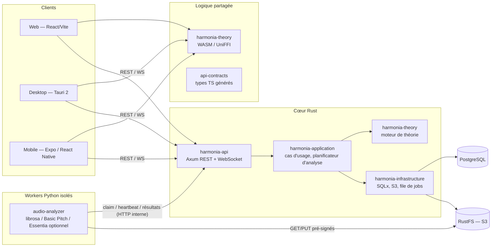
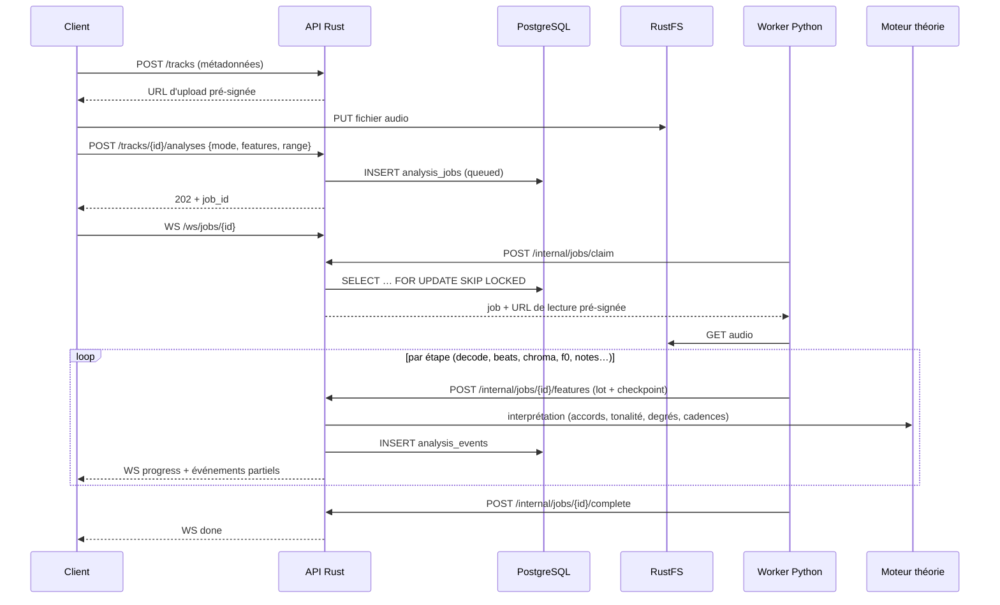
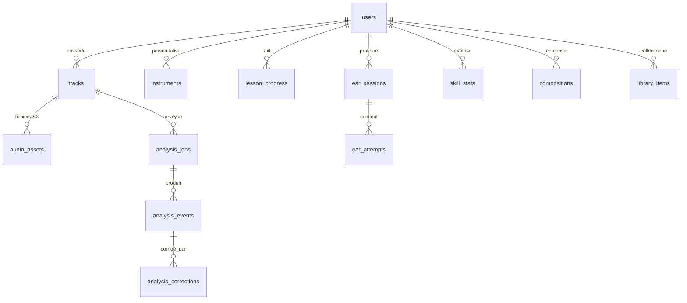

# Harmonia — Architecture technique

> Livrable Phase 1. Ce document fixe les décisions structurantes. Les documents
> voisins détaillent : [bibliothèques et licences](LIBRARIES.md), [API](API.md),
> [plan par phases](ROADMAP.md), [risques de la transcription polyphonique](POLYPHONIC-RISKS.md).

## 1. Principes directeurs

| # | Décision | Raison |
|---|----------|--------|
| D1 | **Un seul moteur de théorie musicale, en Rust pur** (`harmonia-theory`, zéro I/O, zéro dépendance). | Exigence « ne pas dupliquer la logique métier ». Il est consommé par l'API (natif), par le web et Tauri (WASM), et par le mobile (voir D7). |
| D2 | **Python extrait le signal, Rust interprète la musique.** Les workers Python produisent des *features* (chroma, beats, f0, événements de notes). Le nommage des accords, la tonalité, les degrés, cadences et modulations sont calculés par le moteur Rust. | Une seule définition de « ce qu'est un Cmaj7 ». Les workers restent remplaçables. |
| D3 | **Les données théoriques ne sont pas stockées en base.** Gammes, accords, intervalles sont *calculés*. La base ne stocke que ce qui appartient à l'utilisateur. | Cohérence garantie par les tests du moteur, pas par des tables à maintenir. |
| D4 | **File de tâches dans PostgreSQL** (`FOR UPDATE SKIP LOCKED` + heartbeat), pas de Redis/RabbitMQ. | Machines modestes, un service de moins, reprise après interruption native. |
| D5 | **Les workers ne parlent qu'à l'orchestrateur Rust** (API interne) et au stockage objet via URLs pré-signées. Ils n'ont aucun accès direct à la base. | Isolation, même protocole en mode serveur et en mode desktop local. |
| D6 | **Un résultat d'analyse n'est jamais écrasé.** Les corrections manuelles sont une couche séparée appliquée à la lecture. | Traçabilité, ré-analyse possible sans perdre le travail de l'utilisateur. |
| D7 | **Mobile** : le moteur est exposé à React Native par un module natif généré (UniFFI) ; à défaut, par les endpoints `/theory` de l'API. Décision finale en Phase 7 après prototype. | Hermes n'exécute pas WASM de façon fiable ; ne pas réécrire le moteur en TypeScript. |
| D8 | **Stockage derrière un trait** `ObjectStore` : RustFS (S3) en serveur, système de fichiers local en desktop hors ligne. Idem base : PostgreSQL en serveur, SQLite envisagé en desktop (SQLx supporte les deux). | Fonctionnement local sans imposer Postgres + RustFS à un utilisateur desktop. |
| D9 | **Analyse à la demande** : chaque job porte la liste exacte des features voulues ; le planificateur n'exécute que les étapes nécessaires (graphe de dépendances). | Exigence §5 et §13. |

## 2. Vue d'ensemble des services



### Parcours d'une analyse audio



Reprise après interruption : un job dont `heartbeat_at` est trop ancien repasse en
`queued` ; le worker suivant reprend à partir de `checkpoint` (dernière étape validée).

## 3. Architecture audio

Pipeline en étapes indépendantes, chacune déclarant ses dépendances. Le planificateur
(Rust) calcule la fermeture minimale pour les features demandées.

| Étape (worker) | Dépend de | Sortie | Mode minimal |
|---|---|---|---|
| `decode` (mono 22,05 kHz, portion demandée) | — | PCM | Basic |
| `waveform_peaks` | decode | pics multi-résolution (objet S3) | Basic |
| `beats` (onset + suivi de tempo) | decode | BPM, grille de temps, temps forts | Basic |
| `chroma` (CQT/HPCP synchronisé aux temps) | decode, beats | matrice 12×N | Basic |
| `bass_chroma` | decode, beats | chroma grave | Fundamental |
| `f0_melody` (pYIN) | decode | contour f0 + voisement | Advanced |
| `structure` (auto-similarité) | chroma, beats | frontières de sections | Advanced |
| `notes_poly` (Basic Pitch) | decode | événements de notes | Complex |
| `stems` (Demucs, optionnel, mode avancé) | decode | pistes séparées | Complex |

| Interprétation (Rust) | Entrée | Sortie |
|---|---|---|
| Tonalité (profils Krumhansl-Kessler, fenêtrée) | chroma | tonalité principale, secondaires, modulations |
| Accords (gabarits + lissage Viterbi) | chroma, bass_chroma | accords horodatés, renversements si la basse est fiable |
| Degrés, progressions, cadences | accords + tonalité | chiffrage romain, cadences |
| Signature rythmique | beats (périodicité des temps forts) | estimation + confiance |
| Mélodie, riffs | f0 / notes | notes, contour, motifs répétés |

Chaque sortie porte `confidence ∈ [0,1]`, `start_ms`/`end_ms`, et une certitude
`detected | estimated | uncertain` dérivée de seuils documentés par feature.

Lecture côté client : Web Audio API. Ralenti sans changement de hauteur via un
time-stretcher WASM en `AudioWorklet` (hors thread principal). Waveform dessinée sur
Canvas à partir des pics pré-calculés, jamais du PCM complet.

## 4. Arborescence du projet

Les éléments marqués ✅ existent ; les autres sont créés à la phase indiquée —
aucun dossier vide ni crate fictive n'est créé à l'avance.

```
harmonia/
├── Cargo.toml                      ✅ workspace Rust
├── crates/
│   ├── harmonia-theory/            ✅ Phase 2 — moteur de théorie (pur)
│   ├── harmonia-theory-wasm/          Phase 3 — bindings wasm-bindgen
│   ├── harmonia-domain/               Phase 4 — entités : Track, AnalysisJob, AnalysisEvent…
│   ├── harmonia-application/          Phase 4 — cas d'usage, planificateur, ports (traits)
│   ├── harmonia-infrastructure/       Phase 4 — SQLx, ObjectStore S3/local, file de jobs
│   ├── harmonia-audio/                Phase 4 — interprétation des features (accords, tonalité)
│   └── harmonia-api/                  Phase 4 — Axum : REST, WebSocket, API interne workers
├── workers/
│   └── audio-analyzer/                Phase 4 — Python : étapes DSP, client de l'API interne
├── apps/
│   ├── web/                           Phase 3 — React + Vite + Tailwind
│   ├── desktop/                       Phase 7 — Tauri 2 (enveloppe apps/web)
│   └── mobile/                        Phase 7 — Expo / React Native
├── packages/
│   ├── api-contracts/                 Phase 4 — types TS générés depuis OpenAPI
│   ├── theory/                        Phase 3 — chargeur WASM + API TS typée
│   └── audio/                         Phase 3 — synthèse Web Audio, lecteur, time-stretch
├── content/
│   └── lessons/                       Phase 6 — cours versionnés (données, pas du code)
├── db/
│   └── migrations/0001_init.sql    ✅ schéma PostgreSQL
└── docs/                           ✅
```

Règle de dépendance (de l'extérieur vers l'intérieur uniquement) :

```
api → application → domain → theory
infrastructure → application (implémente ses ports)
audio → theory
```

`harmonia-theory` ne dépend de rien. Les contrôleurs HTTP n'appellent jamais de DSP.

## 5. Modèle de données

Schéma complet : [`db/migrations/0001_init.sql`](../db/migrations/0001_init.sql).



Points clés :

- `analysis_events` est une table unique typée par `feature` (`key`, `tempo`, `chord`,
  `note`, `section`, `cadence`, `modulation`…) avec `payload JSONB` validé par le domaine
  Rust. Colonnes communes obligatoires : `start_ms`, `end_ms`, `confidence`, `certainty`.
- `analysis_corrections` : `replace | delete | insert`, jamais de modification de l'événement source.
- `analysis_jobs` porte `features TEXT[]`, la portion (`range_start_ms`/`range_end_ms`),
  `checkpoint JSONB`, `heartbeat_at`, `attempt`.
- `instruments.definition JSONB` sérialise la structure `Instrument` du moteur
  (accordage, tessiture, transposition) : un instrument personnalisé est une donnée.
- Les cours vivent dans `content/lessons/` ; la base ne stocke que `lesson_progress`.

## 6. Modèle du moteur de théorie

| Type | Représentation | Remarque |
|---|---|---|
| `Note` | lettre + altération (`i8`) | Orthographe conservée : `F#` ≠ `Gb`, même `PitchClass`. |
| `Pitch` | `Note` + octave | MIDI et fréquence dérivés ; La4 paramétrable. |
| `Interval` | degrés diatoniques + demi-tons | Qualité dérivée ; distingue `A4` de `d5`. |
| `Scale` | tonique + `ScaleType` | Orthographe correcte par construction (une lettre par degré). |
| `Chord` | fondamentale + `ChordQuality` + basse | Renversements, voicings, identification depuis des notes. |
| `Key` | tonique + mode | Armure, relatif, voisins du cercle des quintes, estimation K-S. |
| `RomanNumeral`, `Progression` | degré + altération + qualité | Indépendant de la tonalité ; transposer = résoudre dans une autre tonalité. |
| `Instrument` | famille + disposition + tessiture + transposition | Cordes frettées ou non, clavier, vent, percussions ; presets et personnalisés. |

## 7. Transversal

- **Erreurs** : `thiserror` par crate, type d'erreur API unique sérialisé en RFC 9457 (`application/problem+json`).
- **Logs** : `tracing` structuré, un `job_id` / `request_id` propagé jusqu'aux workers.
- **Tâches longues** : toujours via `analysis_jobs` ; l'API répond `202` et le suivi passe par WebSocket (repli : polling `GET /analyses/{id}`).
- **Performance** : modèles chargés paresseusement par étape, déchargés après usage ; mode léger = aucune étape à réseau de neurones.
- **Tests** : unitaires dans chaque crate ; intégration API/stockage avec PostgreSQL et RustFS réels (conteneurs) ; jeux d'essai audio synthétiques générés à partir de MIDI connus pour mesurer l'analyseur.
